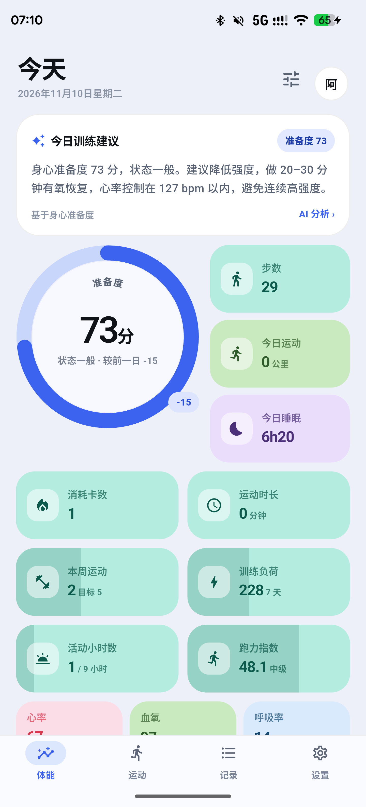
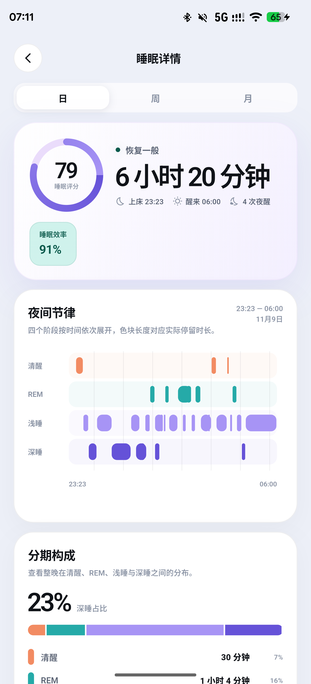
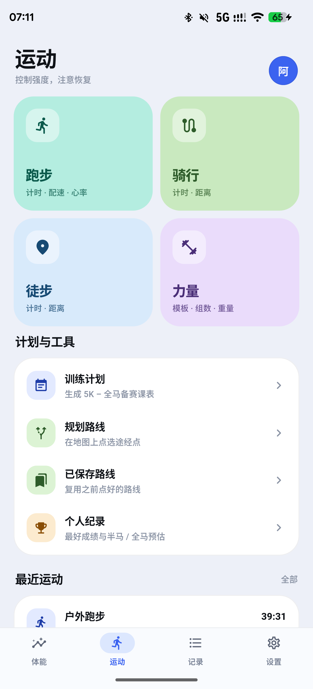
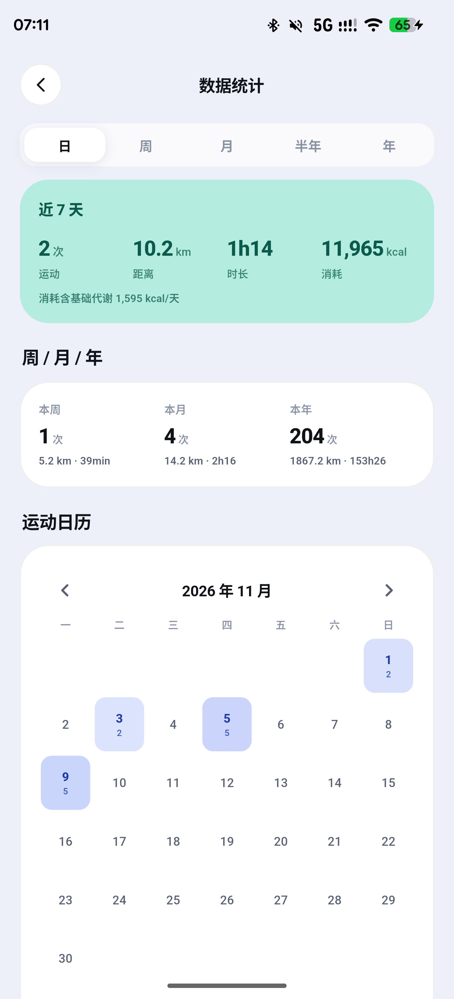
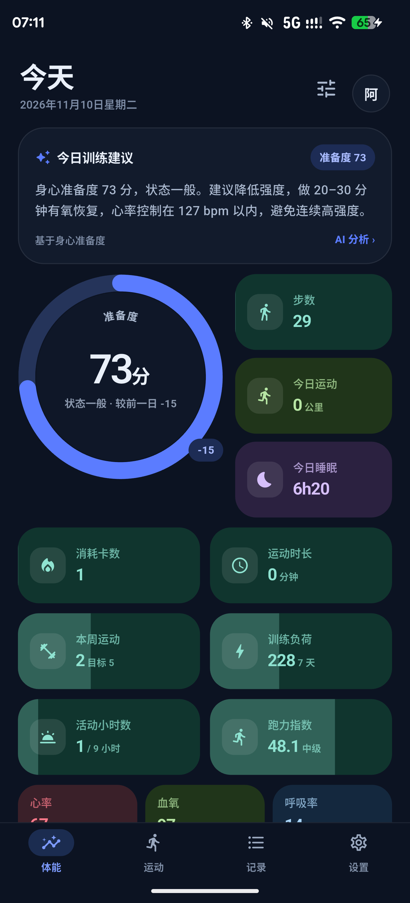
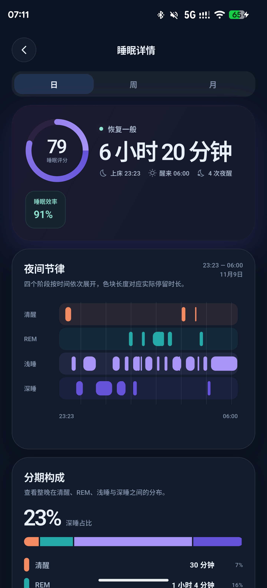
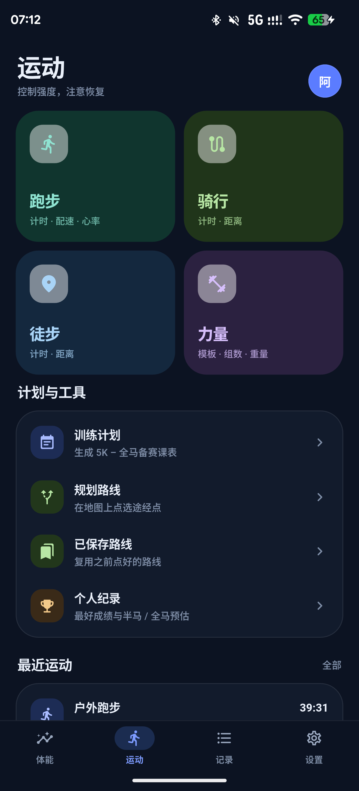
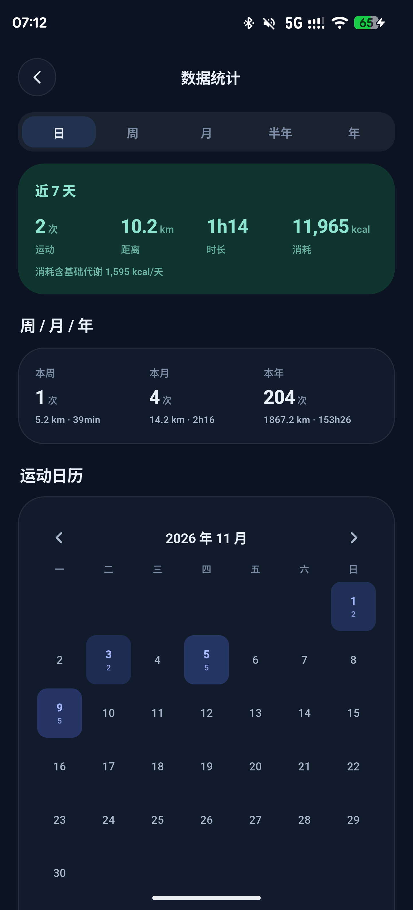

# Vitaloop · 元环

English | [简体中文](README.zh-CN.md)

Vitaloop is an open-source, local-first health and workout dashboard for Android.
It combines a Flutter interface with a Rust data core, direct Huawei wearable
sync, workout analysis, and optional self-hosted services.

> **Status: v0.1 preview.** Local tracking, Huawei watch sync, workout analysis,
> data migration, and export are usable without an account. The public build
> contains no default cloud, ephemeris, or private infrastructure endpoint.

## Screenshots

Captured from the Android development build with illustrative device data.

**Light theme**

| Fitness dashboard | Sleep detail | Workout | Statistics |
|:---:|:---:|:---:|:---:|
|  |  |  |  |

**Dark theme**

| Fitness dashboard | Sleep detail | Workout | Statistics |
|:---:|:---:|:---:|:---:|
|  |  |  |  |

## Features

- Readiness score based on HRV, sleep, resting heart rate, skin temperature,
  stress, and recovery. Missing metrics are excluded and the remaining weights
  are normalized.
- Daily health dashboard for activity, heart rate, SpO2, sleep, stress,
  temperature, weight, blood pressure, and blood glucose.
- Local SQLite storage through Rust and `rusqlite`.
- Huawei watch sync over classic Bluetooth/RFCOMM with HiChain authentication.
  Huawei/Honor authentication and pairing follow
  [Gadgetbridge's pairing guide](https://gadgetbridge.org/basics/pairing/huawei-honor-pairing/),
  and the adapted protocol sources retain their AGPL-3.0 attribution. Existing
  watch credentials are migrated from the legacy app automatically; manual auth
  key entry is intentionally not part of the public build. See
  [docs/HUAWEI_PAIRING.md](docs/HUAWEI_PAIRING.md).
- MapLibre/Protomaps PMTiles basemap when a tile source is configured, with
  Liberty light and dark styles, orange tracks, numbered kilometer markers, and
  road labels.
- Optional AMap raster basemap. Tencent and Baidu provider entries are reserved
  for builds that configure their official SDK keys.
- Workout maps, heart-rate curves, splits, elevation, running dynamics, training
  load, training plans, and GPX/TCX export.
- Long-image sharing for workout details, including the map and all splits.
- One-time migration of supported legacy databases, workout tracks, profile
  data, goals, and Huawei pairing material.
- Optional account-based cloud backup and optional live track sharing against a
  server configured by the user.
- Light and dark themes and nine offline UI languages.

## Privacy model

The public source and build do **not** contain a default cloud server, ephemeris
server, private domain, API key, or signing key.

- Local-only operation requires no account.
- Cloud synchronization is disabled until the user enters a server address and
  signs in.
- Ephemeris download, live track sharing, voice streaming, camera streaming, and
  update checks remain unavailable until a URL is configured.
- The public source ships without a map tile endpoint. After the user configures
  a compatible PMTiles source, map tiles, place search, routing, weather, and
  any provider selected by the user are requested only when the related feature
  is used.
- No advertising SDK or product telemetry is included by default.

Read [PRIVACY.md](PRIVACY.md) and [PERMISSIONS.md](PERMISSIONS.md) before
deploying or modifying network-backed features. Health data, databases, watch
credentials, server tokens, and signing material must never be attached to a
public issue.

## Requirements

- Flutter 3.47+
- Dart 3.13+
- Rust 1.85+
- Android SDK/NDK 27+
- JDK 21

The primary tested target is a Huawei Watch GT 5 paired with a OnePlus phone on
Android 10 or newer. Other watch models, vendors, and aggressive background-power
policies may require additional testing.

## Build and test

```bash
flutter pub get
flutter gen-l10n
flutter analyze
flutter test
(cd rust && cargo test)
flutter build apk --debug
```

Debug APK:

```bash
flutter build apk --debug
```

Unsigned or contributor release build:

```bash
flutter build apk --release --target-platform android-arm64 --split-per-abi
```

Official release keys are injected from the environment. Never commit them:

```text
VITALOOP_KEYSTORE
VITALOOP_KEYSTORE_PASSWORD
VITALOOP_KEY_ALIAS
VITALOOP_KEY_PASSWORD
```

See [docs/RELEASE_SIGNING.md](docs/RELEASE_SIGNING.md) for signing and artifact
verification guidance.

## Optional endpoints

The client is self-hosted-friendly. A cloud server is not bundled with this
repository. The companion server lives in
[monkey-wenjun/vitaloop-server](https://github.com/monkey-wenjun/vitaloop-server):
a single static Rust binary providing accounts, health snapshot/delta sync,
workouts, map style/tile proxying, and a read-only MCP (Model Context Protocol)
endpoint (`POST /mcp`) that lets AI assistants query blood pressure, glucose,
weight, sleep, HRV, and other data with the same account bearer token.

Deploy it with Docker Compose from that repository:

```bash
docker compose up -d   # builds the image and serves 127.0.0.1:8793
```

For a build with a default cloud URL:

```bash
flutter build apk --release \
  --dart-define=VITALOOP_CLOUD_URL=https://sync.example.com
```

The same address can be entered in the app. Without a configured address,
account login/registration and automatic cloud sync are unavailable, while
local features continue to work.

Self-hosted operators are responsible for HTTPS, authentication, access control,
retention, deletion, backups, and recovery. Live track sharing expects the
endpoints documented in the in-app settings; ephemeris download accepts a
compatible `ephemeris.zip` URL. No production endpoint is implied by this
repository.

## Architecture

```text
Flutter UI (Dart)
  lib/ui, lib/state, lib/theme
          │ flutter_rust_bridge
          ▼
Rust core
  rust/src/api, store, readiness, legacy, cloud
          │
          ▼
SQLite on device
```

The Android layer includes a small set of Java protocol and data-model sources
copied or adapted from Gadgetbridge. The relevant attribution and AGPL-3.0
notice are recorded in [NOTICE](NOTICE) and
[THIRD_PARTY_NOTICES.md](THIRD_PARTY_NOTICES.md).

## Repository layout

```text
lib/                    Flutter UI, state, localization, and bridges
rust/                   SQLite, readiness, workout, migration, and sync core
android/                Android integration and Huawei protocol layer
rust_builder/           Cargokit build glue
test/                   Dart tests
docs/                   Release and field documentation
```

## Contributing

Read [CONTRIBUTING.md](CONTRIBUTING.md) for the development, translation, and
sign-off requirements. New contributors should start with an issue that
describes the user problem, data source, permission impact, and privacy impact.

Report vulnerabilities through the repository's **Security → Report a
vulnerability** page. Do not open a public issue for exploitable details or
credential leaks. See [SECURITY.md](SECURITY.md).

## License

Vitaloop is licensed under **AGPL-3.0**. See [LICENSE](LICENSE), [NOTICE](NOTICE),
and [THIRD_PARTY_NOTICES.md](THIRD_PARTY_NOTICES.md).

If you modify Vitaloop and make the modified version available as a network
service, AGPL-3.0 requires you to offer the corresponding source to its users.
Commercial use is allowed; a separately negotiated license is required only if
you need terms that AGPL-3.0 does not permit.
