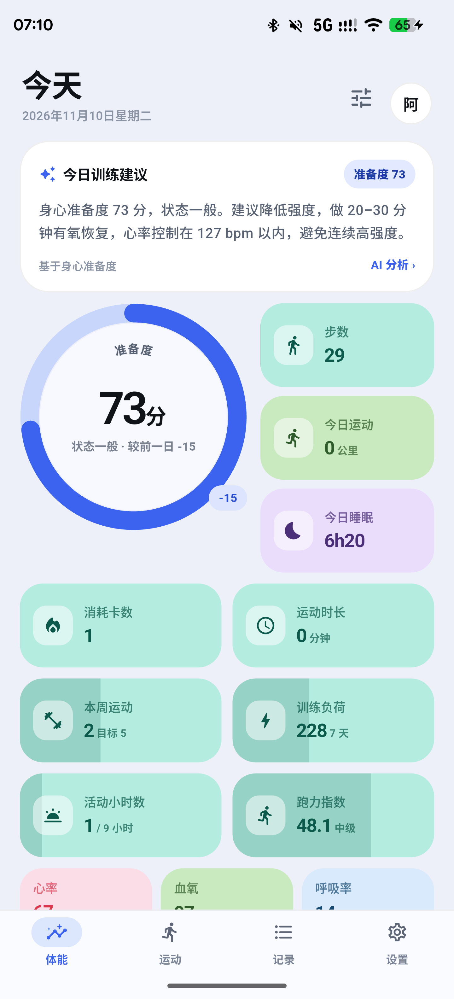
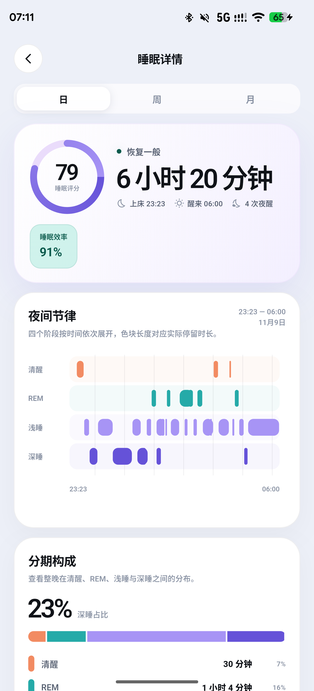
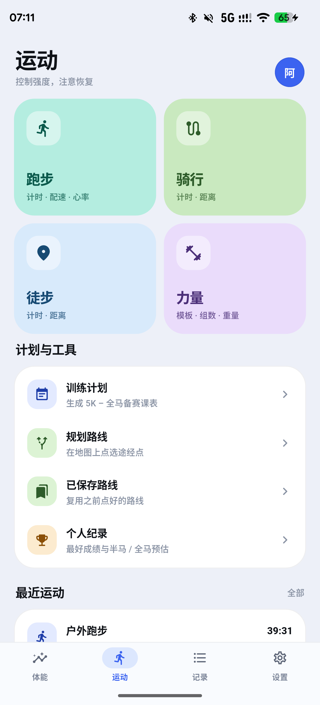
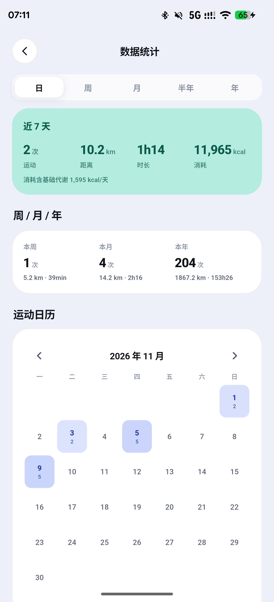
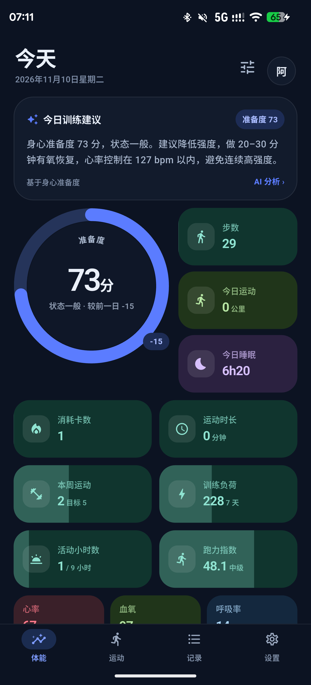
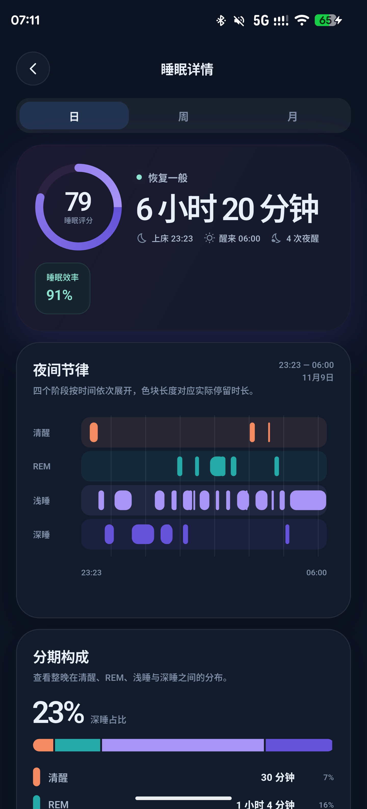
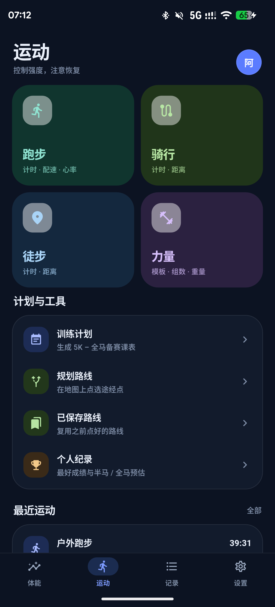
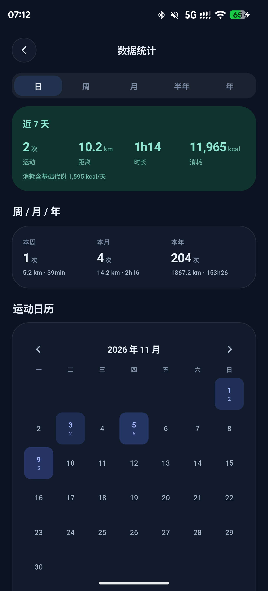

# 元环 · Vitaloop

[English](README.md) | 简体中文

元环是一款开源、本地优先的 Android 运动健康看板。它使用 Flutter 构建界面、
Rust 构建数据核心，支持华为手表直连、运动分析、旧版数据迁移和可选的自建服务。

> **状态：v0.1 预览版。** 本地记录、华为手表同步、运动分析、数据迁移和导出均可在
> 不登录的情况下使用。公开源码和构建不包含默认云服务、星历服务、私有域名或凭据。

## 截图

截图来自 Android 开发版，画面中的设备数据仅用于展示。

**亮色主题**

| 体能首页 | 睡眠详情 | 运动 | 数据统计 |
|:---:|:---:|:---:|:---:|
|  |  |  |  |

**暗色主题**

| 体能首页 | 睡眠详情 | 运动 | 数据统计 |
|:---:|:---:|:---:|:---:|
|  |  |  |  |

## 功能

- **身心准备度**：综合 HRV、睡眠、静息心率、皮温、压力和运动恢复计算分数。
  缺少某项指标时自动剔除该项并重新分配权重。
- **今日总览**：步数、热量、距离、活动时长、心率、血氧、睡眠、压力、体温、
  体重、血压和血糖。
- **本地存储**：数据先写入设备内的 SQLite，Rust 通过 `rusqlite` 访问。
- **手表同步**：经典蓝牙 RFCOMM + HiChain 认证，增量同步健康数据和运动记录。
  华为/荣耀设备的认证与配对流程参考
  [Gadgetbridge 配对指南](https://gadgetbridge.org/basics/pairing/huawei-honor-pairing/)，
  改编的协议源码继续保留 AGPL-3.0 归属说明。Vitaloop 内的具体步骤——包括手表
  已绑定官方 App 时如何录入认证 key **免恢复出厂**直接连接——见
  [docs/HUAWEI_PAIRING.md](docs/HUAWEI_PAIRING.md)（当前仅中文）。
- **矢量地图**：配置 PMTiles 瓦片源后使用 MapLibre + Protomaps，提供 Liberty
  亮色、Dark 暗色、橙色轨迹、公里编号和道路名称。
- **地图来源可选**：可切换高德栅格底图；腾讯、百度入口保留给配置官方 SDK Key 的构建。
- **运动详情**：轨迹地图、心率曲线、公里分段、爬升、跑步动态、训练负荷、
  训练计划以及 GPX/TCX 导出。
- **长图分享**：运动详情可选择当前页或长图；长图包含地图和完整公里分段。
- **旧版迁移**：支持导入旧版健康数据库、运动轨迹、个人资料、目标和手表配对材料。
- **可选云同步**：用户填写自己的服务器地址并登录后，可选择备份完整健康快照。
- **可选实时共享**：填写服务地址和令牌后，才会上传实时位置、心率和电量。
- **界面**：亮色/暗色主题，九种离线界面语言。

## 隐私与网络

公开源码和公开构建**不内置**云服务器、星历服务器、私有域名、API Key 或签名证书。

- 不登录即可完整使用本地功能。
- 没有配置服务器地址时，账号登录、注册和自动云同步不可用。
- 星历下载、实时轨迹、语音推流、相机推流和更新检查在配置 URL 前不会联网。
- 公开源码不内置地图瓦片服务地址。用户配置兼容的 PMTiles 瓦片源后，地图、
  地点搜索、路线吸附、天气及用户切换的底图只在对应功能使用时请求。
- 默认不包含广告 SDK 或产品遥测。

部署或修改联网功能前，请阅读 [PRIVACY.md](PRIVACY.md) 和
[PERMISSIONS.md](PERMISSIONS.md)。请勿在公开 issue 中附加健康数据、数据库、
手表认证材料、服务器令牌或签名文件。

## 环境要求

- Flutter 3.47+
- Dart 3.13+
- Rust 1.85+
- Android SDK/NDK 27+
- JDK 21

当前主要验证环境为 OnePlus 手机（Android 10+）连接 Huawei Watch GT 5。其他手表、
Android 厂商和后台省电策略可能需要额外适配。

## 构建与测试

```bash
flutter pub get
flutter gen-l10n
flutter analyze
flutter test
(cd rust && cargo test)
flutter build apk --debug
```

Debug APK：

```bash
flutter build apk --debug
```

贡献者或未签名 Release：

```bash
flutter build apk --release --target-platform android-arm64 --split-per-abi
```

正式发布签名只从环境变量读取，不写入仓库：

```text
VITALOOP_KEYSTORE
VITALOOP_KEYSTORE_PASSWORD
VITALOOP_KEY_ALIAS
VITALOOP_KEY_PASSWORD
```

签名和产物校验说明见 [docs/RELEASE_SIGNING.md](docs/RELEASE_SIGNING.md)。

## 可选服务地址

本仓库只包含客户端，不包含可直接部署的云同步服务端。配套服务端见
[monkey-wenjun/vitaloop-server](https://github.com/monkey-wenjun/vitaloop-server)：
单个静态 Rust 二进制，提供账号体系、健康快照/增量同步、运动记录、地图样式/瓦片代理，
以及只读 **MCP（Model Context Protocol）** 接口（`POST /mcp`），AI 助手可用同一账号
Bearer 会话直接读取血压、血糖、体重、睡眠、HRV 等数据。

在该仓库根目录用 Docker Compose 一键部署：

```bash
docker compose up -d   # 构建镜像并监听 127.0.0.1:8793
```

如果希望构建一个带默认云地址的版本：

```bash
flutter build apk --release \
  --dart-define=VITALOOP_CLOUD_URL=https://sync.example.com
```

也可以在 App 的登录页手动填写服务器地址。没有配置地址时，账号功能不可用，
但本地数据功能不受影响。

自建服务运营者需要自行负责 HTTPS、认证、访问控制、数据保留、删除、备份和恢复。
实时轨迹共享使用 App 内说明的接口；星历下载接受兼容的 `ephemeris.zip` 地址。
本仓库不提供生产地址，也不对外承诺任何官方服务器。

## 架构

```text
Flutter UI (Dart)
  lib/ui, lib/state, lib/theme
          │ flutter_rust_bridge
          ▼
Rust Core
  rust/src/api, store, readiness, legacy, cloud
          │
          ▼
设备内 SQLite
```

Android 层包含少量从 Gadgetbridge 复制或改写的 Java 协议和数据模型源码。
版权与 AGPL-3.0 归属记录在 [NOTICE](NOTICE) 和
[THIRD_PARTY_NOTICES.md](THIRD_PARTY_NOTICES.md)。

## 目录

```text
lib/                    Flutter 界面、状态、本地化和桥接
rust/                   SQLite、准备度、运动、迁移和同步核心
android/                Android 集成与华为协议层
rust_builder/           Cargokit 构建胶水
test/                   Dart 测试
docs/                   发布和数据字段说明
```

## 参与贡献

开发、翻译和 DCO 签署要求见 [CONTRIBUTING.md](CONTRIBUTING.md)。新功能应先通过
issue 说明用户问题、数据来源、权限影响和隐私影响。

安全问题请通过仓库的 **Security → Report a vulnerability** 私下报告，不要在公开
issue 中披露可利用细节或凭据。详见 [SECURITY.md](SECURITY.md)。

## 许可证

本项目以 **AGPL-3.0** 发布。详见 [LICENSE](LICENSE)、[NOTICE](NOTICE) 和
[THIRD_PARTY_NOTICES.md](THIRD_PARTY_NOTICES.md)。

你可以自由使用、修改和商业使用本项目。如果修改后的版本作为网络服务提供给
用户，AGPL-3.0 要求你向这些用户提供对应的完整源码。若需要 AGPL-3.0 不允许的
闭源条款，请单独取得版权持有人的商业授权。
